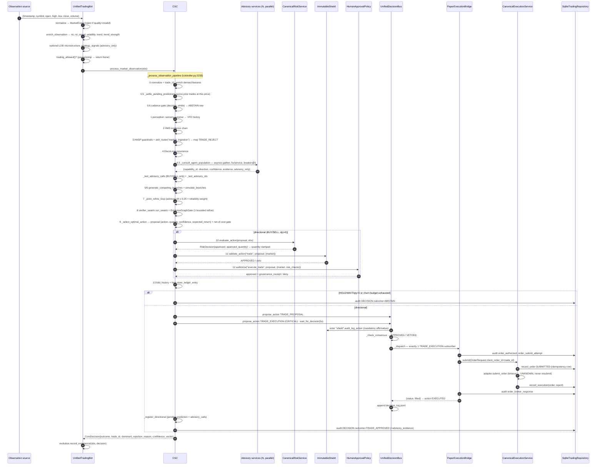
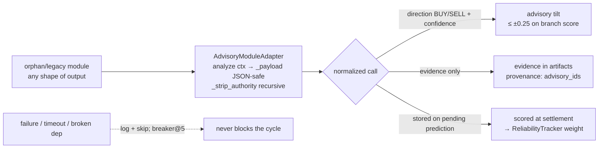
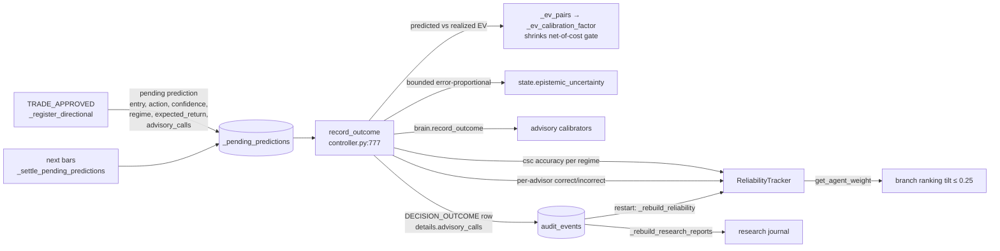
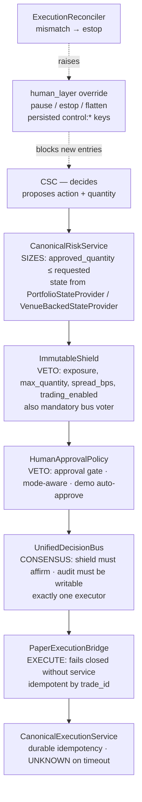

# AlphaAlgo — Canonical Runtime Architecture & Data Flow

Traced from code (not from names) on the merge-six tree. Every box below
cites the file and function that implements it. Packages not on this spine
are classified in §7 — advisory, live-dependency, or quarantined.

Governing invariant (enforced by `tests/foundation/test_orphan_ai_quarantine.py`
and `tests/foundation/test_brain_quarantine.py`):

> `CognitiveSystemController` (CSC) is the sole decision authority. Nothing
> else may approve, size, veto, or execute. Risk sizes; Shield + Governance
> veto; the LogAct bus reaches consensus; exactly one execution bridge fills.

---

## 1. Layered overview

```mermaid
flowchart TB
    subgraph L0["L0 · Entry points"]
        M[main.py<br/>replay_observations / synthetic_observations]
        PR[scripts/paper_runner.py<br/>--source db|synthetic --discover-advisors]
        MT[scripts/mt5_demo_runner.py<br/>live M15 bars, demo only]
        CLI[scripts/operator_cli.py<br/>pause/resume/flatten/estop]
    end

    subgraph L1["L1 · Application boundary"]
        RT[foundation/runtime.py<br/>ModularMonolithRuntime]
        UB[unified_bot.py<br/>UnifiedTradingBot]
    end

    subgraph L2["L2 · Observation pipeline (per bar)"]
        NZ[data/normalizer.py<br/>MarketDataNormalizer.normalize]
        EN[unified_bot.enrich_observation<br/>RSI-14, volatility, ER trend]
        LOB[market_feeds LOBFeed<br/>optional microstructure]
        STR[strategies/registry.py<br/>signals · advisory_only=True]
        HG[human_layer.is_trading_allowed<br/>fail-closed gate]
    end

    subgraph L3["L3 · The One Brain — core/csc/controller.py"]
        CSC[CognitiveSystemController<br/>process_market_observation]
    end

    subgraph L4["L4 · Capital gates (directional proposals only)"]
        RS[risk/service.py<br/>CanonicalRiskService.evaluate_action<br/>SIZES — approved_quantity clamps proposal]
        SH[core/immutable_shield.py<br/>shield.validate_action<br/>VETO]
        GV[governance/policy_adapter.py<br/>HumanApprovalPolicy.authorize<br/>VETO]
    end

    subgraph L5["L5 · Consensus + execution"]
        BUS[core/unified_event_bus.py<br/>UnifiedDecisionBus · LogAct<br/>voters → consensus → dispatch]
        BR[core/execution_bridge.py<br/>PaperExecutionBridge.execute<br/>exactly 1 TRADE_EXECUTION subscriber]
        ES[execution/service.py<br/>CanonicalExecutionService.submit<br/>idempotent by client_order_id]
        AD[PaperBrokerAdapter · MT5DemoAdapter<br/>BrokerAdapter port]
    end

    subgraph L6["L6 · Durable state + feedback"]
        REPO[(persistence/repositories.py<br/>SqliteTradingRepository<br/>orders · fills · positions · audit_events)]
        DL[(decision_log.jsonl<br/>LogAct audit)]
        REC[execution/recovery.py<br/>ExecutionReconciler<br/>venue vs ledger]
        RL[core/csc/reliability.py<br/>ReliabilityTracker]
        EV[evolution_layer.record_trade_experience]
    end

    subgraph L7["L7 · Read-only projections"]
        RM[interfaces/read_models.py<br/>ModularMonolithReadModel]
        DASH[interfaces/adapters.py<br/>Dashboard · Reporting · Notification]
        SNAP[(snapshot.json)]
    end

    M --> RT
    PR --> RT
    MT --> RT
    CLI -. control:* keys .-> REPO
    RT --> UB
    UB --> NZ --> EN --> LOB --> STR --> HG --> CSC
    CSC --> RS --> SH --> GV --> BUS
    BUS --> BR --> ES --> AD
    ES --> REPO
    BR --> REPO
    BUS --> DL
    CSC --> REPO
    REPO --> REC
    REC -. mismatch → emergency_stop .-> HG
    CSC --> RL
    RL -. agent weights .-> CSC
    UB --> EV
    REPO --> RM --> DASH --> SNAP
```

---

## 2. Boot sequence (`UnifiedTradingBot.start`, unified_bot.py:87–275)

Order matters — each component is registered once in `core/unified_registry`:

| # | Component | File | Role |
|---|---|---|---|
| 1 | `decision_bus` (LogAct) | core/unified_event_bus.py | shared decision log + consensus |
| 2 | `hms` HierarchicalMemorySystem | core/hms/memory.py | evidence chain retrieval, ledger storage |
| 3 | `shield` ImmutableShield | core/immutable_shield.py | governance veto; registers itself as bus voter `"shield"` |
| 4 | `world_model` WorldModelV2 | world_model/v2_core.py | latent state (torch) — live dep, non-advisory |
| 5 | normalizer / strategy registry / capability registry / `skill_router` (+ `rsi_signal` skill) | data/, strategies/, foundation/, core/csc/router.py | observation plumbing |
| 6 | `evolution_gate`, `verification_swarm` (+ optional debate capability) | governance/, core/verification/swarm.py | verification BEFORE synthesis |
| 7 | `portfolio_risk_service` CanonicalRiskService (+ optional legacy policies) | risk/service.py | **sizing authority** |
| 8 | `trading_repository` → `execution_service` → `PaperExecutionBridge.attach(bus)` → `restore_state()` | persistence/, execution/service.py, core/execution_bridge.py | durable ledger, idempotent boundary, single executor |
| 9 | `csc` CognitiveSystemController(world_model, hms, skill_router, verifier_swarm, risk_engine, consensus_engine=bus, evolution_gate, shield) | core/csc/controller.py | the one brain |
| 10 | optional layers: telemetry, evolution, human (approval gate, alerts, override) | telemetry/, evolution_layer/, human_layer/ | services, never decision-makers |

Then `ModularMonolithRuntime.start` (runtime.py:31–37) adds:
`_configure_decision_audit` (bus log path — shielded actions veto if unwritable)
→ `_wire_csc_persistence` (CSC decision sink = repository; optional
`AdvisoryCognitiveBrain`) → `ExecutionReconciler` → `_recover_execution_state`
(pending orders reconciled by broker lookup, never resubmitted; venue/ledger
mismatch → `emergency_stop.trigger`) → read-model projections.

---

## 3. Per-bar data flow (`UnifiedTradingBot.run_cycle`, unified_bot.py:426–487)



### Terminal outcomes and where they are produced

| `DecisionOutcome` | Produced at | Reason examples |
|---|---|---|
| `ABSTAIN` | cadence gate, no viable branch, verified HOLD/WAIT, churn guard | `cadence_skip`, `turnover budget exhausted` |
| `TRADE_REJECTED` | guardrails, verification, risk, shield, governance, consensus | `HASP PF Intervention`, `Risk: approved_quantity is 0`, `Shield: …`, `Governance: …`, `LogAct consensus failure` |
| `TRADE_APPROVED` | after bus EXECUTED/APPROVED | fill registered as pending prediction |

---

## 4. The AI / cognition stack — inside CSC

Everything in this section lives inside `_process_observation_pipeline`
(controller.py:2233). Three planes run per bar: **state** (what the system
believes), **evidence** (what advisors and memory contribute), and
**selection** (how a proposal survives to the gates in §6).

```mermaid
flowchart TB
    OBS[enriched observation<br/>{price, ohlcv, rsi, volatility,<br/>trend, trend_strength, sentiment,<br/>microstructure, strategy_signals}]

    subgraph STATE["STATE PLANE — what the system believes"]
        VFE[_calculate_sensory_surprise<br/>prediction error vs last_prediction → vfe_history]
        DL[DiscoLoopCell.transition ×3<br/>512-dim projection of obs → hidden_state + discrete tokens<br/>bounded channel = last 100]
        WM[world_model/v2_core.py WorldModelV2<br/>latent state · asset_dims {FX:64, Equities:128}]
        OH[_obs_history deques<br/>strictly-prior closes → derived features]
        HMS[core/hms/memory.py<br/>HierarchicalMemorySystem<br/>retrieve_evidence_chain + store_ledger_entry]
    end

    subgraph EVIDENCE["EVIDENCE PLANE — advisory, never authority"]
        PCA[agents/pca.py<br/>MacroAgent · RiskAgent · AlphaAgent<br/>update_beliefs → think → share_artifact]
        SVC[91 factory services + --discover-advisors scan<br/>advisory.py — asyncio.gather, 5s each,<br/>breaker after 5 consecutive failures]
        ACB[cognition/advisory_adapter.py<br/>AdvisoryCognitiveBrain — opt-in<br/>enable_cognitive_advisory]
        RES[research artifacts<br/>csc/research/engine.py reports queued<br/>into next cycle's evidence]
        ADA[AdvisoryModuleAdapter<br/>strips authorized*/risk_*/veto/order/qty<br/>→ {capability_id, direction, confidence,<br/>evidence, advisory_only: True}]
    end

    subgraph SELECT["SELECTION PLANE — one proposal survives"]
        HG[csc/hypothesis.py HypothesisGenerator<br/>bull/bear/range/hold branches<br/>priors = sentiment·0.2 + signal_vote·0.45 + vol]
        SIM[simulate_branches on WorldModel<br/>→ invalidation_triggers + expected_value]
        PR[_pivot_refine_loop<br/>score = conf·prob·(1−uncertainty)·(1 + 0.25·tilt)<br/>tilt = Σwᵢcᵢsignᵢ/Σwᵢcᵢ, wᵢ = get_agent_weight]
        VS[core/verification/swarm.py<br/>VerificationSwarm + EvidenceGraphGate<br/>+ one bounded refine pass]
        SYN[_select_optimal_action + net-of-cost gate<br/>EV must beat calibrated cost_bps]
        FL[InformationFolder.fold_history<br/>ledger → HMS]
    end

    OBS --> VFE
    OBS --> OH
    OBS --> DL
    OBS --> HMS
    OBS --> PCA
    OBS --> SVC
    PCA --> ADA
    SVC --> ADA
    ACB --> ADA
    RES --> ADA
    ADA -->|advisory_artifacts| HG
    HMS -->|evidence_chain| HG
    WM --> HG
    HG --> SIM --> PR --> VS --> SYN --> FL
    FL --> HMS
    PR -.tilt source.-> SVC
```

### What each AI component actually is

| Component | File | Nature |
|---|---|---|
| Perception (VFE) | controller.py `_calculate_sensory_surprise` | prediction error of `last_prediction` vs this bar — real surprise, not a constant |
| DiscoLoop | `DiscoLoopCell` (controller.py:49) | recurrent cell; obs projected deterministically into a 512-d signal, 3 loops per bar |
| World model | `world_model/v2_core.py` | injected into `HypothesisGenerator`; latent state for causal simulation — live dep, never advisory |
| Memory | `core/hms/memory.py` | evidence chain retrieval pre-branching; `store_ledger_entry` post-fold |
| PCA population | `agents/pca.py` | 3 persistent agents (macro/risk/alpha) with per-agent belief updates; failures log & skip |
| Advisory services | `core/csc/advisory.py` | 91 factories + optional discovery; evidence only, authority fields stripped at the boundary |
| Cognitive brain | `cognition/advisory_adapter.py` | `AdvisoryCognitiveBrain` — whole cognition package exposed as ONE advisory service when enabled |
| Branch generation | `csc/hypothesis.py` | heuristic priors labelled `heuristic_prior` — explicitly not calibrated probabilities |
| Simulation | `simulate_branches` | produces `invalidation_triggers` + `expected_value` per branch |
| Pivot/refine | `_pivot_refine_loop` | ranked by `conf·prob·(1−unc)` scaled ≤±25% by reliability-weighted advisory tilt; failed branch → next viable → `pivot_branch` |
| Verification | `core/verification/swarm.py` | swarm reports + `EvidenceGraphGate.verify_evidence_first`; one bounded refine, then reject |
| Synthesis | `_select_optimal_action` | proposal + `_apply_net_of_cost_gate` — calibrated EV must beat cost |
| Research engine | `csc/research/engine.py` | `run_research_cycle` every `research_interval` bars; reports re-enter as advisory artifacts |

### The advisory contract — how AI feeds the brain without authority



- **Tilt is bounded and earned**: `weight = get_agent_weight(cap, regime)`
  starts at 1.0 and only moves after ~10 scored outcomes; aggregate tilt is
  normalized to [−1,1] then scaled by `_ADVISORY_TILT = 0.25`.
- **A directional advisor can never execute**: its output carries no
  quantity/order fields after stripping; it only biases which reasoning
  branch wins — the simulation filter, EV gate, churn guard, risk sizing,
  shield, governance, and consensus all still apply downstream.

### Introspection: `trading_bot/ai_stack.py`

`AIStack(csc)` is the read-only surface for this section — it snapshots
the three planes (`state_plane()`, `evidence_plane()`, `selection_plane()`)
and renders one-line explanations (`explain()`). It is wired by
`ModularMonolithRuntime._wire_csc_persistence` as `runtime.ai_stack`,
registered in the component graph as `interface_ai_stack`
(read-only, `capital_path: none`), and projected to dashboards via
`ModularMonolithReadModel.ai_stack()` / `dashboard_snapshot()`. It has no
method that approves, sizes, vetoes, or executes — introspection only.
Standalone render of this section's diagrams: `DOCS/ai_stack_diagram.mmd`
/`DOCS/ai_stack_diagram.html` (open the HTML in a browser; it renders the
mermaid via CDN).

---

## 5. Feedback loops (what closes the learning cycle)



- **Advisors earn influence by evidence**: a capability's weight only moves
  when its BUY/SELL call is scored against the realized move.
- **Restart-safe**: reliability and research journals are rehydrated from
  `audit_events`; execution state is rehydrated from `orders`
  (`CanonicalExecutionService.restore_state`) and reconciled against the
  venue before any new entry.

---

## 6. Safety topology — who may do what



Fail-closed defaults verified in code: missing risk engine → reject; missing
governance gate → reject; no shield voter → veto; audit log unwritable → veto;
0 or >1 executors → FAILED; human layer missing → `trading_allowed()` False.

---

## 7. Where every `trading_bot/` package sits (227 dirs)

**Canonical spine (imported on the live path)**
`core` (csc, hms, verification, immutable_shield, unified_event_bus,
execution_bridge, unified_registry) · `foundation` · `unified_bot.py` ·
`data` · `strategies` · `risk` · `execution` · `governance` · `human_layer` ·
`persistence` · `interfaces` · `brokers` (mt5_demo) · `market_feeds` ·
`evolution_layer` · `telemetry` · `evaluation` (synthetic market) ·
`recursive_self_improvement` (RSI research, protected-path guarded) ·
`cognition` (canonical advisory stack: `AdvisoryCognitiveBrain`, adapter).

**Live-imported, non-advisory dependencies** (`LIVE_IMPORTED_NON_ADVISORY`)
`world_model` (WorldModelV2 — torch), `alpha_engine`,
`autonomous_financial_intelligence`.

**Attached through the advisory seam** (`DEFAULT_ADVISORY_FACTORIES`, 91 ids,
all wrapped by `AdvisoryModuleAdapter` → authority fields stripped)
`agents` · `agents2` · `market_intelligence` · `core_agent_system` ·
`intelligence_core` · `adversarial_decision` · `alphaalgo_core` ·
`alpha_research` · `alphaalgo_institutional` · `brain` ·
`cognitive_architecture` · `elite_ai_system` · `adaptive_systems` ·
`intelligence` · `self_learning` · `signal_discovery` · `tamic` ·
`self_diagnostic` · `aletheia_autonomous` · `superintelligence` ·
`systems_ai` · `advanced_intelligence` · `improvement_agent` ·
`neural_integration` · `radar_ai` · `self_concepts` · `self_healing_ai` ·
`self_mastery` · `sentient_core` · `superpowerful_ai` · `ai` · `ai_core` ·
`aads` · `aamis_v3` · `autonomous_learner` · `explainability` + root files
`world2agent.py`, `aean_meta_intelligence_layer.py`, `alphaalgo_5star.py`,
`elite_master_system.py`, `complete_implementation.py`.

**Quarantined — declared unwired with a reason** (`UNWIRED_ORPHAN_MODULES`)
`autonomous_superintelligence` (torch-chained) · `intel` (external data) ·
`meta_learning` (echo stub) · `ai_engineer` (approval semantics) ·
`learning` (offline RL) · `unified_ai_brain.py` (parallel brain) · and every
remaining root `.py` (shadowed / stub / facade / capital path / utility).

**Legacy parallel systems — not on the live path, kept for research/tests**
Parallel bots & orchestrators: `ultimate_bot`, `ultimate_system`,
`ultimate_production`, `ultimate_architecture`, `unified_system`,
`unified_architecture`, `master_system`, `elite_system`, `orchestrator`,
`orchestration`, `autonomous_pipeline`, `golden_path`, `apex_fi`, `msos`,
`cos`, `hivemind`, `hedge_fund`, `institutional`, `institutional_entry`,
`trading`, `production`, `realtime`, `realtime_trading_core`,
`system_supervisor`, `services`.
Parallel risk/execution/approval (superseded by L4/L5):
`risk_management`, `risk_unified`, `hedging`, `hedge_fund_safety`,
`stealth_safety`, `safety`, `approval`, `unified_approval`,
`ultimate_approval`, `decision_governance`, `decision_layer`,
`meta_governance`, `reality_gates`, `position`, `portfolio`,
`profit_maximizer`, `market_making`, `hft`, `arbitrage`, `derivatives`,
`crypto`, `broker`, `ctrader`, `connectors`, `bridges`.
Legacy RSI duplicates (DeprecationWarning, no authority — AGENTS.md):
`recursive_improvement`, `eternal_evolution`, `alpha_evolve`,
`auto_optimizer`, `optimization`, `self_improvement`, `improvements`,
`neuros_evolution`, `innovations`, `upgrades`, `critical_fixes`.
Research / ML / analytics (offline): `ml`, `advanced_ml`, `models`,
`features`, `indicators`, `signals`, `strategy`, `simulation`,
`backtesting`, `analysis`, `analysis_unified`, `advanced_analysis`,
`analytics`, `research`, `research_ingestion`, `market_student`,
`market_teacher`, `psychology`, `sentiment`, `macro`, `alternative_data`,
`opportunity_scanner`, `perplexity_trading`, `quantum`, `multimodal`,
`reasoning`, `skills`, `adversarial_curriculum`, `adversarial_verification`,
`deepchart`, `visualization`, `advanced_features`, `advanced_systems2`,
`alphaalgo_v2`, `qwen_codemender`, `deepseek_engineer`,
`deepseek_engineer_pkg_tmp`, `ai_engineer`.
Data / infra / ops / UI (not decision-bearing): `data_feeds`,
`data_sources`, `database`, `ingestion`, `streaming`, `event_pipeline`,
`events`, `event_monitoring`, `connectivity`, `connectivity_unified`,
`internet_access`, `api`, `core_api`, `dashboard`, `mobile`, `mobile_app`,
`voice_assistant`, `notifications`, `alerts`, `reporting`, `monitoring`,
`observability`, `metrics`, `log_system`, `diagnostics`, `system_health`,
`profiling`, `performance`, `quality`, `validation`, `testing`, `tests`,
`tools`, `utils`, `config`, `schemas`, `registry`, `error_handling`,
`security`, `compliance`, `audit`, `surveillance`, `trade_journal`,
`trading_calendar`, `exits`, `exit_strategies`, `filters`, `feedback`,
`automation`, `devops`, `deployment`, `cloud_deployer`, `infrastructure`,
`distributed`, `ops`, `global_expansion`, `wealth`, `social`, `gets`,
`blockchain`, `documentation`, `integration`, `integrations`, `system`,
`autonomous`, `_archive`.

---

## 8. Operational surfaces

| Need | Command |
|---|---|
| Paper soak, real bars | `python scripts/paper_runner.py --source db --cycles 400 --discover-advisors --state-dir var/wire_audit` |
| Paper soak, synthetic | `python scripts/paper_runner.py --source synthetic --cycles 40 --state-dir var/paper_run --interval 0` |
| Operator control | `python scripts/operator_cli.py --state-dir <dir> pause\|resume\|flatten\|cancel-all\|estop\|reset-emergency\|status` |
| MT5 demo (hermes env) | `python scripts/mt5_demo_runner.py --replay 30 --auto-approve --state-dir var/mt5_demo` |
| Idempotency fault gate | `python scripts/fault_gate.py --events 10000 --state-dir <tmp>` |

State lives under `<state-dir>/trading_state.db` (tables: orders, fills,
positions, audit_events, account_state incl. `control:*`) plus
`decision_log.jsonl` (LogAct) and `snapshot.json` (read model).
